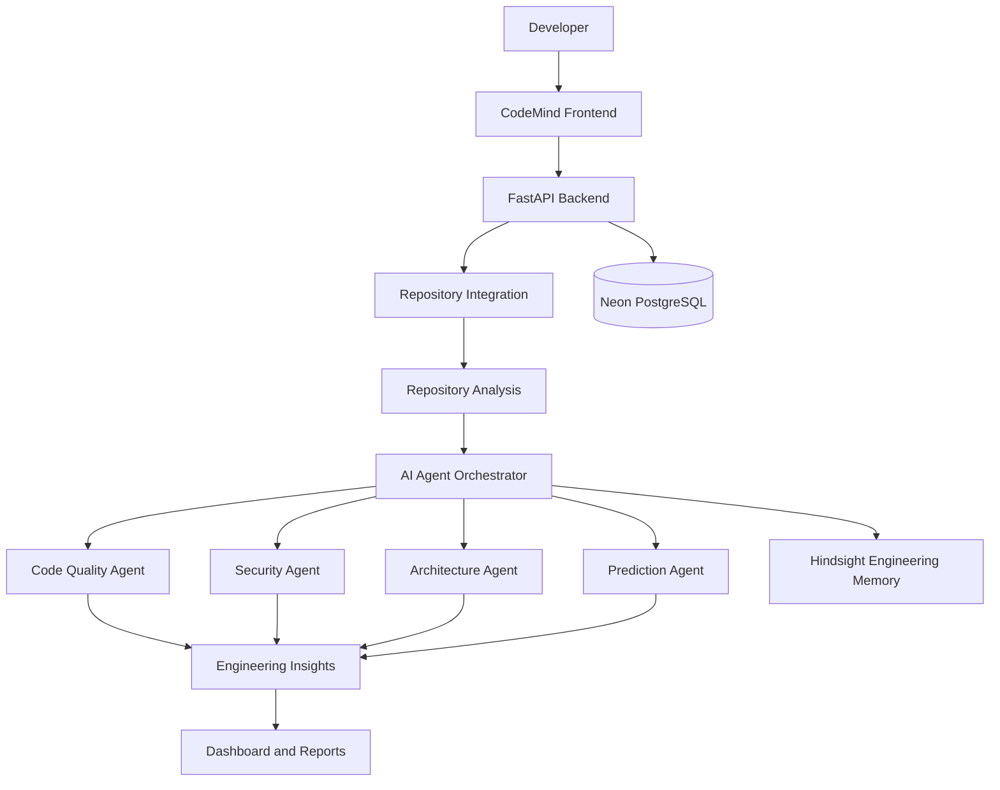

# CodeMind

### AI-Powered Engineering Intelligence for Modern Software Repositories

**Understand your codebase. Identify risks. Predict what comes next.**

CodeMind is an AI-powered engineering intelligence platform designed to help developers understand, analyze, and improve complete software repositories.

It brings together code quality analysis, security insights, architectural intelligence, AI-powered agents, predictive insights, and engineering memory to provide a deeper understanding of software systems.

Instead of relying on multiple disconnected tools and manually inspecting thousands of lines of code, CodeMind aims to give developers a unified view of their codebase and its engineering health.

---

## The Problem

As software projects grow, understanding and maintaining them becomes increasingly difficult.

Developers and engineering teams face challenges such as:

- Understanding unfamiliar or large codebases.
- Identifying potential security vulnerabilities.
- Detecting code quality issues and technical debt.
- Understanding architectural dependencies and structural problems.
- Predicting areas of future maintenance risk.
- Retaining engineering knowledge across development cycles.

Traditional development tools often provide isolated insights, leaving developers to connect the dots themselves.

## Our Solution

CodeMind aims to bring these insights together through an intelligent repository analysis platform.

It combines automated analysis with specialized AI agents to help developers move beyond simply identifying issues toward understanding their impact and deciding what to improve next.

## Core Capabilities

### 1. Repository Intelligence
- Analyze complete GitHub repositories.
- Understand project structure and source code.
- Build contextual understanding of repository components.
- Identify relationships between different parts of a codebase.

### 2. Code Quality Analysis
- Identify potential code quality issues.
- Highlight maintainability concerns.
- Detect patterns that may contribute to technical debt.
- Provide actionable improvement suggestions.

### 3. Security Intelligence
- Identify potential security vulnerabilities.
- Highlight suspicious code patterns.
- Explain security findings in understandable language.
- Help developers prioritize potential risks.

### 4. Architectural Intelligence
- Understand repository architecture and organization.
- Identify structural and dependency-related concerns.
- Evaluate architectural quality.
- Highlight potential design and maintainability problems.

### 5. Predictive Engineering Insights
- Identify potential future engineering risks.
- Highlight areas that may require maintenance.
- Provide AI-assisted recommendations for improving long-term codebase health.

### 6. AI Agent Orchestration
CodeMind uses specialized AI agents to support different aspects of repository analysis.

The objective is to combine multiple perspectives into a unified engineering assessment rather than relying on a single general-purpose AI response.

### 7. Engineering Memory
CodeMind explores the use of persistent engineering context to retain useful knowledge about software projects.

With Hindsight integration, the goal is to provide historical context that can help improve future analysis and recommendations.

---

## How CodeMind Works

The intended analysis workflow:

1. **Repository Input:** The developer provides a GitHub repository.
2. **Repository Understanding:** CodeMind examines the repository structure and relevant source code.
3. **Specialized Analysis:** Different analysis agents evaluate code quality, security, and architecture.
4. **Intelligence Generation:** The platform combines findings into engineering insights.
5. **Risk Identification:** Potential issues and future maintenance risks are highlighted.
6. **Recommendations:** Developers receive explanations and suggested improvements.
7. **Engineering Memory:** Relevant project knowledge can be retained for future analysis as the memory integration is developed.

---

## System Architecture



*Architecture represents the intended system design. Individual integrations and persistence capabilities are subject to implementation and deployment verification.*

---

## Technology Stack

| Layer | Technology |
|---|---|
| Frontend | React / TypeScript |
| Backend | Python / FastAPI |
| AI Integration | Groq |
| Engineering Memory | Hindsight |
| Database | Neon PostgreSQL |
| Repository Platform | GitHub |
| Frontend Deployment | Vercel |
| Backend Deployment | Render |
| Testing | Pytest |
| Code Quality | Ruff |

---

## Project Structure

```text
CodeMind/
│
├── backend/
│   ├── app/
│   │   ├── core/
│   │   ├── agents/
│   │   ├── api/
│   │   ├── services/
│   │   └── main.py
│   │
│   ├── tests/
│   └── pyproject.toml
│
├── frontend/
│   ├── src/
│   ├── public/
│   └── package.json
│
├── README.md
└── ...
```

*The directory overview is illustrative; refer to the repository for the current implementation.*

---

## Getting Started

### Prerequisites

- Python 3.12+
- Node.js
- pnpm
- Git
- GitHub account

### 1. Clone the Repository

```bash
git clone https://github.com/poovaragansiva-collab/code-mind.git

cd code-mind
```

### 2. Backend Setup

```bash
cd backend

uv sync
```

Create a `.env` file using the environment variable names documented in the backend configuration.

Do not commit API keys, database credentials, private keys, or other secrets.

Start the backend:

```bash
uv run uvicorn app.main:app --reload
```

Backend API:

```text
http://localhost:8000
```

### 3. Frontend Setup

Open another terminal:

```bash
cd frontend

corepack pnpm install

corepack pnpm dev
```

Open the local frontend URL displayed in your terminal.

### 4. Run Backend Tests

```bash
cd backend

uv run pytest
```

### 5. Run Ruff

```bash
cd backend

uv run ruff check .
```

---

## Deployment

CodeMind uses the following deployment infrastructure:

| Component | Platform |
|---|---|
| Frontend | Vercel |
| Backend | Render |
| Database | Neon PostgreSQL |

**Live Project:** https://codemind-saiyans2.vercel.app

**Backend:** https://codemind-api-live.onrender.com

---

## Current Development Status

CodeMind is being developed as a hackathon MVP.

Our current focus is building and validating the core repository analysis workflow.

| Component | Development status |
|---|---|
| Frontend application | Implemented |
| FastAPI backend | Implemented |
| AI agent orchestration | Implemented / under validation |
| Code quality analysis | Under development |
| Security analysis | Under development |
| Architecture intelligence | Under development |
| Predictive insights | Under development |
| GitHub integration | Configuration and validation in progress |
| Hindsight integration | Configuration and validation in progress |
| Neon database persistence | Integration and validation in progress |

*Status reflects development progress, not a guarantee that every feature is production-ready.*

---

## Roadmap

### Phase 1 — MVP
- [x] Initial frontend and backend setup
- [x] FastAPI application
- [x] Initial AI agent architecture
- [ ] Complete repository ingestion workflow
- [ ] Validate specialized analysis agents
- [ ] Integrate repository analysis with the dashboard

### Phase 2 — Engineering Intelligence
- [ ] Improve code quality assessment
- [ ] Expand security analysis
- [ ] Develop architectural quality scoring
- [ ] Introduce predictive engineering insights
- [ ] Improve recommendation accuracy

### Phase 3 — Persistent Engineering Memory
- [ ] Validate Hindsight integration
- [ ] Retain repository-specific engineering context
- [ ] Track historical analysis insights
- [ ] Improve recommendations using previous findings

### Phase 4 — Product Expansion
- [ ] Team-level engineering intelligence
- [ ] Repository health monitoring
- [ ] Historical risk tracking
- [ ] Continuous analysis workflows
- [ ] Production-grade scalability

---

## Why CodeMind?

We believe developers should spend less time trying to understand what is happening inside a codebase and more time improving it.

CodeMind aims to transform repository analysis from disconnected technical checks into a unified engineering intelligence experience.

The long-term vision is to build a platform that doesn't just tell developers what is wrong, but helps them understand why it matters and what might happen next.

---

## Team

Built by a team of six student developers as part of a Microsoft hackathon.

We are exploring the intersection of AI, software engineering, repository intelligence, and developer productivity.

---

## Contributing

We welcome feedback, ideas, and contributions.

If you have suggestions, discover issues, or want to contribute:

1. Fork the repository.
2. Create a feature branch.
3. Make your changes.
4. Run the available tests.
5. Submit a pull request.

---

## Links

- **Live Application:** [https://codemind-saiyans2.vercel.app](https://codemind-zeta.vercel.app/)
- **GitHub Repository:** https://github.com/poovaragansiva-collab/code-mind

---

<p align="center">
  <strong>CodeMind — Understand. Analyze. Predict. Improve.</strong>
</p>

<p align="center">
  Built with curiosity and a vision for smarter software engineering.
</p>
